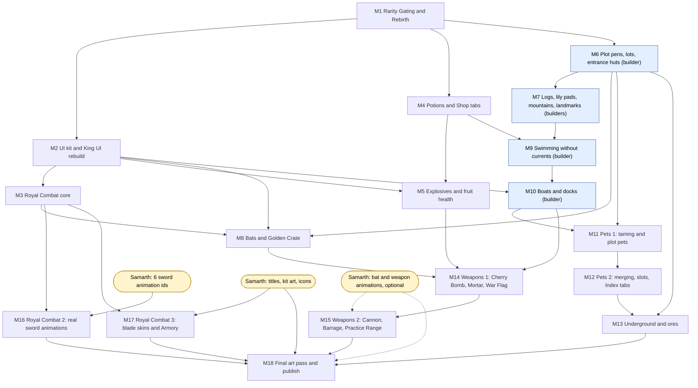

# Roadmap: building the Fruit Empire expansion

This note puts the 11 system specs in `02 Systems` into a build order. Each milestone is small enough to build, test and ship on its own, and each one leaves the game playable in Studio. What Samarth has to make or do is listed in [[Asset Requests]]. The numbers every price reads come from the [[Stage Model]]. Conflicts between specs were settled in the [[Integration Review]].

**Status on 4 Oct 2026:** every spec is a proposal. None of the expansion code is built yet (each spec says so in its header).

**Words used here**
- **Milestone (M1, M2, ...)**: one shippable step. It ends with tests passing in Studio, then a Save and Publish by Samarth.
- **Playable in Studio**: you can press Play and use the new feature end to end, with every older feature still working.
- **Placeholder / fallback**: what the game shows until Samarth's art or animation id exists, for example FredokaOne text on the kit's blue title bar. Typing the id in later is a one-line change.
- **Builder**: an Edit-mode script in `ServerStorage.ZZTools` that changes the map. Every builder refuses to run outside place 88602028667228, uses a fixed seed (so a re-run gives the same parts), stamps `Builder`, `Seed` and `Version` attributes, moves what it replaces into a dated ServerStorage backup with a `WasIn` attribute, prints its part counts and has an `undo()` ([[Plot Overhaul and Environment]] rule J4).
- **Dev door**: a Studio-only player attribute that changes your state for testing, for example `DevSetRebirths`.
- **StudioNoSave**: run `workspace:SetAttribute("StudioNoSave", true)` before every playtest, or the playtest writes your real save (`GardenStore.lua:572-575`).
- **Stage**: rebirths + 1, from 1 (Common) to 9 (Transcendent).
- **Size**: a rough estimate. **S**: under 300 changed lines, a few files, no map change. **M**: 300 to 1,000 lines, or one builder. **L**: 1,000 to 2,500 lines across 10 or more files, or a map rebuild of every plot.

## Order rules
1. **Economy first.** [[Rarity Gating and Rebirth]] sets the stage and owns the one shared shard price and reward (`Config.ShardPrice`, `Config.ShardReward`, D-017). Every other system prices against it, so it is M1.
2. **The shared UI kit second.** Pets, Mine, Boat Dock and Armory panels, every bar and the overlap checker come from `UIKit` ([[King UI Overhaul]] 8.1), so it is M2.
3. **Code before art.** Every image and animation slot has a fallback. A milestone that only needs art to look finished ships with placeholders. The two milestones that cannot work without Samarth's supply (M16 sword animations, M17 blade skins) come last.
4. **Risky map changes go through builders with backups.** The plot rebuild, the log, lily pad and mountain swaps, the current removal, the docks and the Practice Range each run through a re-runnable builder with a dated backup and an undo. One builder runs at a time, and Samarth looks at screenshots before saving.
5. **Each milestone ships alone.** No milestone leaves a half-built feature in the live game.

## Build order at a glance

**Status (9 Oct 2026):** M1 to M5 are built and verified in Studio ([[M1 Verification]] to [[M5 Verification]]); they go live when Samarth publishes. M6 (plot pens, lots, entrance huts) and M7 (world restyle: logs, lily pads, mountains, landmarks) are built, deployed, their builders have run in Studio and they are checked in Play ([[M6 Verification]], [[M7 Verification]]); they wait for Samarth's "go" on the screenshots and design calls. M8 (Bats and the Golden Crate) is built, deployed, its builder has run and it is checked in a solo Play test ([[M8 Verification]]); the two- and three-player tests are Samarth's. M9 (swimming without currents) is built, deployed, its two tools have run and it is checked in a solo Play test ([[M9 Verification]]). On 8-9 Oct, at Samarth's ask, the King's Throne came out of the cloud island, the crown became a 15,000-shard cosmetic shown only on the richest player, and a Settings panel and Index rarity tabs went in ([[MK Verification]]). On 9 Oct the Cloud Garden got Sky Stars: 12 daily gold stars to find, a counter, and bounce mushrooms that throw you onto floating cloud puffs (also in [[MK Verification]]). M6, M7, M9 and that work all wait for his "go" before Publish. Next: M10 (boats and docks).

| # | Milestone | Main spec | Depends on | Samarth first | Size |
|---|---|---|---|---|---|
| M1 | Rarity Gating and Rebirth | [[Rarity Gating and Rebirth]] | none | decisions only | L |
| M2 | UI kit and King UI rebuild (code only) | [[King UI Overhaul]] | M1 | nothing | L |
| M3 | Royal Combat core | [[Royal Combat]] | M2 | nothing | L |
| M4 | Potions and the Shop tabs | [[Potions]] | M1 | nothing | M |
| M5 | Explosives and fruit health | [[Explosives and Fruit Health]] | M2, M4 | nothing | L |
| M6 | Plot pens, lots and entrance huts | [[Plot Overhaul and Environment]] | M1 | screenshot approval | L |
| M7 | World restyle: logs, lily pads, mountains, landmarks | [[Plot Overhaul and Environment]] | M6 | screenshot approval | M |
| M8 | Bats and the Golden Crate | [[Bats]] | M2, M3, M6 | nothing | L |
| M9 | Swimming without currents | [[Boats and Swimming]], [[Potions]] | M4, M7 | screenshot approval | M |
| M10 | Boats and docks | [[Boats and Swimming]] | M2, M9 | screenshot approval | L |
| M11 | Pets 1: wild animals, taming, plot pets | [[Pets]] | M6, M10 | nothing | L |
| M12 | Pets 2: merging, slots, Index category tabs | [[Pets]], [[Underground and Ores]] U4 | M11 | nothing | M |
| M13 | Underground and ores | [[Underground and Ores]] | M6, M12 | nothing | L |
| M14 | Weapons 1: Cherry Bomb, Mortar, War Flag | [[Weapons and Artillery]] | M5, M8, M10 | nothing | L |
| M15 | Weapons 2: Cannon, Barrage, Practice Range | [[Weapons and Artillery]] | M14 | nothing | M |
| M16 | Royal Combat 2: real sword animations | [[Royal Combat]] | M3 | **the 6 animation ids** | S |
| M17 | Royal Combat 3: blade skins and the Armory | [[Royal Combat]] | M3 | **title, buttons, bars** | M |
| M18 | Final art pass, checks and publish | all | everything | remaining art | S |

Two lanes can run side by side if wanted: the royal lane (M2, M3, M16, M17) touches only the Crown files, and the island lane (M4 to M15) touches the garden files. The shared files where both lanes meet are `GardenConfig.lua`, `ShopMenu.lua` and `RebirthLock.lua`.

M16 can move up to right after M3 the day Samarth sends the six ids.

## Dependency diagram

Yellow nodes are what Samarth supplies. Blue nodes change the map through builders.

## Rules for every milestone
- **Before each playtest:** set StudioNoSave. Use the dev doors (`DevSetRebirths`, `DevSetShards`, `DevSetCash`, `DevFillIndex`, and each milestone's own) instead of grinding.
- **Save fields:** every new field goes into both `Store.Default()` and `sanitise` in `GardenStore.lua`, or it is dropped on the next load (`GardenStore.lua:447-450`). No schema bump: adding fields is forward and backward compatible (`GardenStore.lua:8-12`). The full list of new fields is [[Integration Review]] section 5.
- **Remotes:** every client-to-server remote is type-checked and re-validated on the server ([[Integration Review]] section 6).
- **HUD:** every new cluster goes into `Config.HudClusters`, the HUD table in [[Integration Review]] section 4, and `UIOverlapCheck` (from M2 on). Every new panel joins `UIKit.Modals`, so only one panel is open at a time.
- **Look:** FredokaOne, kit images, no emoji, no code-drawn boxes.
- **Ship:** tests pass in Studio, then Samarth does File > Save to Roblox and File > Publish to Roblox ([[Asset Requests]], last section). When the save document changes, shut down the old servers. For M1 this is required.
- **Art:** an image or animation id is typed in the day it passes moderation. It needs no milestone. M18 sweeps up whatever is left.

## Start now, in parallel with M1 (Samarth)
These take the longest and nothing in M1 waits on them ([[Asset Requests]] checklist):
1. Publish the six sword animations with the four `Hit` events (R34). This is the only item that blocks a milestone (M16).
2. The Figma title batch (R1). M1 needs only REBIRTH and MAX FRUIT.
3. The pending royal icons (R8 to R11) and the pending Feather Falling and Luck art (R13).
4. Reply "defaults ok for M1" or name the open questions to change.

---

## M1. Rarity Gating and Rebirth (economy foundation)
- **Goal:** each rebirth opens exactly one new rarity. A fresh save can merge only up to Apple, sees Sealed Index cards with padlocks, gets the Max Fruit popup, and can rebirth through the rebuilt Rebirth menu once its Index, cash and shards are all met. A rebirth gives the next rarity, +25% cash (added) and +1 storage. It also fixes two live bugs: a tool in hand is destroyed by a rebirth, and a rebirth can race a merge animation.
- **Specs and sections:** [[Rarity Gating and Rebirth]] (Rules 1 to 24, Numbers tables 1 to 4, UI U1 to U11, Code plan, Test plan); [[Stage Model]] (the stage table); decisions D-006 to D-011, D-017 (shared shard price and reward), D-019 (Luck refused at the ceiling), D-020 (Plot Size kept; the explosive refund hook is guarded until M5), D-026 (`MinDiscovered = 5`), D-033 (no rebirth while fighting).
- **Scripts touched:**
  - New: `ServerScriptService.GardenService.RarityGate`; `StarterPlayerScripts.MaxFruitPopup` and `GardenUI.MaxFruitPopup`; a rebuilt `GardenUI.RebirthMenu`; `ServerStorage.RebirthBurst` (a copy of `Stars-01`); remote `RarityGate`.
  - Server: `GardenService.lua` (remote, require, dev doors `DevSetRebirths` and `DevFillIndex`), `GardenConfig.lua` (the rarity-gate block and the shared helpers `StageFor`, `CapRankFor`, `SpawnCeilingFor`, `HeadStartLevelFor`, `ShardDropFor`, `NicePrice`, `ShardPrice`, `ShardReward`, `StoredCapFor`, `RebirthStatus`, `RarityOrder`; `RebirthCashBonus = 0.25`), `Merging.lua`, `Upgrades.lua` (cap-aware price; `spawnPlan` caps Luck at the ceiling, built once for [[Potions]] too), `Progression.lua`, `Carrying.lua`, `Storage.lua`, `RebirthLock.lua` (new gate, no shard payout, no Index wipe, Plot Size kept, head start, `stowTool`, arena refusal), `Persistence.lua` (migration in `applyProfile`), `GardenStore.lua`, `Crown.lua` (comment only), `CrownConfig.lua` (`MinDiscovered = 5`).
  - Client: `GardenClient.lua` (cap prompt, no match glow at the cap, storage badge), `IndexMenu.lua` (Sealed state, "Found n/m"), `RebirthMenu.lua` (rewritten), `UpgradeMenu.lua`, `StoredFruitsMenu.lua`, `AlertBadges.lua`, `EarnPopups.lua` (the purple "+N" shards).
- **New save fields:** `gateVersion` (0 or 1). The one-time Placement migration raises `rebirths` to cover the fruit a player already owns and clamps `upgrades.spawnTier` with a cash refund. It is idempotent. `index` is no longer wiped by a rebirth, and `upgrades.plotSize` is kept.
- **Test plan (spec T1 to T16, solo Studio play with dev doors):** cap at Apple, prompt reads "Max Fruit", popup once (T1); no Tomato or Apple ever spawns (T2); Luck refused at the ceiling (T3); Merge All stops at the cap (T4); each need turns green and the badge appears only after all three (T5); rebirth keeps Index, shards minus the cost, Plot Size, and storage reads 0/6 (T6); head start at Dandelion (T7); +7 shards per Uncommon merge (T8); storage refuses the 9th fruit at Rebirth 3 (T9); Sealed cards read "Rebirth 1" to "Rebirth 8" (T10); migration places a save correctly and a second load changes nothing (T11, T12 self-test); a held potion or TNT is stowed on rebirth (T13); rebirth refused mid-merge (T14); Rebirth 8 shows "Every rarity is unlocked" (T15); no overlap on phone, tablet and desktop (T16).
- **Samarth supplies first:** nothing to make. Confirm open questions 1 to 6, 19 and 43, or reply "defaults". Save to Roblox once before the build starts, so version history has a clean point to roll back to. Art (R1 to R6) can land any time; until then the titles use the blue bar with Fredoka text and the LOCKED plate uses the tinted Maxed plate.
- **Ship:** publish, then shut down all old servers (required: the migration must not meet old code).
- **Size:** L.

## M2. UI kit and King UI rebuild (code only)
- **Goal:** one shared kit module that every new screen uses, and the royal screens rebuilt from Samarth's kit: no emoji, no overlaps, no code-drawn frames, one panel at a time. Playable result: the royal chip, action pill, event strip, herald, Kingdom panel with four tabs, challenge dialog and reskinned castle boards, all with fallbacks where art is missing.
- **Specs and sections:** [[King UI Overhaul]] rules 1 to 36 and 39 to 40, sections 4 and 5 (5.1 to 5.8, 5.10 to 5.12), 8.1 to 8.5, build order steps 1 to 3 and the Shop King tab and KingClient parts of step 4 (the combat buttons and legend wait for M3); [[Integration Review]] section 4 and conflicts C24 to C26, C40, C41.
- **Scripts touched:**
  - New: `ReplicatedStorage.UIKit` (font, text sizes, `pill`, `bar`, `icon`, `clone`, `Modals`, `Slot`), `ReplicatedStorage.UIKitPrefabs`, the six `RoyalUI` child modules (`Herald`, `Strip`, `Hud`, `Confirm`, `Panel`, `World`), `StarterPlayerScripts.UIOverlapCheck` (Studio only), `ServerStorage.ZZTools.RoyalSignsReskin` (reskins the castle boards in place, idempotent).
  - Changed: `RoyalUI.lua` (wiring only), `ButtonAnimator.lua` (`KitButtons`), `KingClient.lua`, `ShopMenu.lua` (King tab pills, `OpenShopTab`), `CrownConfig.lua` (the `C.Text` rewrite, Title Case, `Icons.Lock`, `Icons.Reign`, `TitleImages`, `CombatButtons`, `UI`, `CameraEmphasis = false`), `Crown.lua` (plain toasts, `applyBoardTitles`, `RoyalQuery` limit, board strings), `CrownArena.lua` (scoreboard lines, trial text), `CrownDecree.lua` (plain text, the `decrees` answer), `RoyalCapitalBuilder.lua` (board function and titles for future re-runs). The hard-coded "hide the other panels" lists in `ShopMenu.lua`, `IndexMenu.lua`, `StoredFruitsMenu.lua`, `UpgradeMenu.lua` and `RebirthMenu.lua` switch to `UIKit.Modals`.
- **New save fields:** none.
- **Test plan ([[King UI Overhaul]] tests 1 to 22 and 25 to 27; Clients and Servers with 3 players):** emoji scan, icons at 0 show no gap, Fredoka everywhere, the text ladder, `UIOverlapCheck` on four devices through idle, duel, contest, decree and toast states, phone pill, one modal, arena focus, herald queue, sound and stinger scope, no camera move, strip priority, chip states and badge, panel actions, the query limit, gamepad, castle boards after `RoyalSignsReskin`, overhead title, Shop King tab pills, KingClient off, Text Size Largest.
- **Samarth supplies first:** nothing. Confirm 39 to 42 (40 changes D-001 so an id of 0 shows no icon). R1, R7 and R8 to R11 land whenever ready.
- **Size:** L.

## M3. Royal Combat core (no art, no publishing)
- **Goal:** duels with health instead of stagger, a 4-step combo, a charged heavy strike, block and parry, the rebuilt Royal Slam, hit sparks and damage numbers, and royal and decree rewards that scale with stage. It runs on today's classic swing until M16. Playable: spar a knight solo, duel a second client, run a contest with three.
- **Specs and sections:** [[Royal Combat]] Rules A to F, H and I (skins, rule G, wait for M17), Numbers (combat moves, HP, the shard unit, royal rewards), UI (board and fighter bars, damage numbers, touch buttons, PC ability bar and legend, arena focus), World (effects, sounds), build order step 1; [[King UI Overhaul]] rules 37 and 38 (combat visuals); decisions D-017, D-028, D-033.
- **Scripts touched:**
  - New: `ReplicatedStorage.RoyalFX` (slash, spark, flash, number, shake, hit stop, telegraph, slam impact, shockwave), `ReplicatedStorage.RoyalFXAssets` (copies of the staging-area effects it uses).
  - Changed: `CrownConfig.lua` (`Combat`, `Knight`, `Anims` all 0, `RewardUnits`, decree `rewardUnits`, `RepeatPairWindow`, sounds), `CrownArena.lua` (HP, combo, parry, hitstun, slam, `publishBout`, stage rewards, the repeat-pair rule, knights with HP, `UnequipTools` before the sword), `CrownContest.lua`, `CrownDecree.lua`, `Crown.lua` (`royalGiveStageShards`, `royalSpendShards`), `RoyalCombat.lua` (client combo, F1 to F7 and ring A10 slots with fallbacks, legend, ability bar, arena focus hides every garden cluster except Mute), the `RoyalUI` modules from M2 (`hit`, `swing`, `slamStart`, `slam`, `shockwave`, `dash` handlers, board bars, fighter tags).
- **New save fields:** none.
- **Test plan ([[Royal Combat]] tests 1 to 16, 23, 24, 26, 27, 29, 31 to 34; [[King UI Overhaul]] tests 23 and 24):** HP 100 on both sides; the combo deals 7, 7, 8, 12; chain and finisher timing; whiff stun; finisher distance grows at low HP; knockdown point at 0 HP; parry and riposte; block chip damage; slam timing and damage; hit stop; at most 12 damage numbers; stage rewards and the 30-minute repeat-pair rule; rebirth refused in the arena; clusters hide and return; classic swing works with all ids at 0; under 5 KB/s added per client.
- **Samarth supplies first:** nothing. Confirm 13, 32 and 33. Start R34 (the sword animations) now, for M16.
- **Size:** L.

## M4. Potions and the Shop tabs
- **Goal:** today's six potions get stage-scaled shard prices, are drunk straight from the Inventory (no need to free your hands), keep their time left when you leave and rejoin, and show in a tidy effect block (bottom right with a mouse, top left on touch). The Shop gets its final four tabs: Potions, Weapons, King, Robux. Playable: buy each potion at different rebirths, drink while carrying a fruit, rejoin with time left.
- **Specs and sections:** [[Potions]] rules 1 to 31, except Aqua Affinity (ships in M9) and Haste (later); Numbers (formulas, catalogue, price table); UI 1 to 4; Code plan. Decisions D-019, D-022.
- **Scripts touched:**
  - New: `ServerScriptService.GardenService.Potions`, remote `DrinkTool`, `ShopMenu.PotionsTab` and `PotionsPage` (the renamed Tools tab and page), `WeaponsTab` and `WeaponsPage` (until M5 the Weapons page holds today's TNT card).
  - Changed: `GardenConfig.lua` (`ShopTabs`, potion `priceUnits` and `order`, `ToolPrice`, effect `order`, effect block numbers), `Tools.lua` (stage price in `buyTool`, `consumeTool` calls `G.drink`, export `takeTool`), `GardenService.lua` (remote, `drunk` table, `clearEffects`, teardown, expiry sweep), `Ambient.lua` (`potionSweep`), `Persistence.lua` (capture and restore effects), `GardenStore.lua` (`effects`), `DevPanel.lua`, `ShopMenu.lua` (a grid per page, potion cards), `StoredFruitsMenu.lua` (Drink button), `GardenClient.lua` (effect block grid), `HudScale.lua` (effect block placement).
- **New save fields:** `effects` (seconds left per effect, only entries of 30 s or more, at most 86,400).
- **Test plan ([[Potions]] T1 to T4, T6 to T14, T16, T18 to T21):** four tabs with six cards in order; prices match the table at Rebirths 0, 2, 5 and 8; server refuses an unaffordable buy; prices repaint on rebirth; drink while carrying; the old Equip path still works; bad `DrinkTool` calls refused; durations stack; arena hides the block; reset clears effects; effects survive a rebirth; a Round trip restores time left; Luck refused at the ceiling; drink puff seen by others; no overlap on four devices; only your own attributes are written; the saved `effects` passes the self-test.
- **Samarth supplies first:** nothing. Confirm 12, 36 and 37. Feather Falling and Luck art (R13) is still pending; their placeholders are already in the game.
- **Size:** M.

## M5. Explosives and fruit health
- **Goal:** TNT drains fruit health instead of wiping fruit. Four explosives (TNT, Big TNT, Mega TNT, Nuke) unlock at stages 2, 4, 6 and 8. At 0 HP a fruit is stunned for 20 s and earns nothing, then comes back with a 30 s shield; it is never destroyed. The Lock blocks blasts. Rebirth refunds explosives in shards. Playable with 2 clients (attacker and owner).
- **Specs and sections:** [[Explosives and Fruit Health]] rules 1 to 35, Numbers N1 to N7, UI 6.1 to 6.10, World 7.1 to 7.4, Code plan 9.1 to 9.7. Decisions D-017, D-020, D-027 (one bar pair), D-030, D-031.
- **Scripts touched:**
  - New: `ReplicatedStorage.ExplosiveConfig`, `GardenService.Explosives` (`placeExplosive`, `blast`, `damageFruit`, `refundExplosives`, `registerBlastTarget`), `StarterPlayerScripts.FruitHealthClient`, remote `ExplosiveFx`, tool models `TNT1` (today's `TNT`, renamed), `TNT2`, `TNT3`, `Nuke`, `ReplicatedStorage.WeaponFx` (created here, shared with M14), `workspace.ArmedExplosives`.
  - Changed: `GardenConfig.lua`, `GardenService.lua` (remote, require, dev door `DevExplosivesSelf`, teardown), `Tools.lua` (`buyTool` unlock and price, `useTool` explicit branches), `FruitFactory.lua` (`plotBase` skips stunned fruit; export `clampToPlot`), `Merging.lua` (Merge All skips stunned fruit), `RebirthLock.lua` (refund before the rebirth count rises), `Ambient.lua` (`EmpirePower`), `Crown.lua` and `CrownDecree.lua` (read `EmpirePower`, so a stun cannot swing the throne), `GardenStore.lua` (`RETIRED_PRICES.tnt`), `ShopMenu.lua` (explosive cards on the Weapons page), `GardenClient.lua`, `EarnPopups.lua`, `AlertBadges.lua` (the Lock "!"), `DevPanel.Server.lua`.
- **New save fields:** `tools` keys `TNT1`, `TNT2`, `TNT3`, `Nuke`. Each old `TNT` is refunded at 2,500 shards and dropped. Health, stuns and armed explosives are runtime only.
- **Test plan ([[Explosives and Fruit Health]] section 12, rules 1 to 33 and 35, plus UI; rule 34 waits for M13):** unlocks by rebirth; prices match N4; rebirth refund is exact; the old `TNT` is refunded; every placement refusal keeps the item in hand; fuse times; Lock blocks and returns the item; no damage to the neighbour plot, carried fruit or players; damage values at 0, 5 and 10 studs; effective stage uses the lower of the two; Nuke fallout and the Lock mid-fallout; HP bands; regen after 10 s; stunned fruit cannot be picked up or merged and earn nothing; attacker gains nothing; bad remote calls refused; no overlap.
- **Samarth supplies first:** nothing. Confirm 9, 20 to 23, 25 and 45. Fruit bars use the kit bar fallback until A8 and A9 (R7) land. The Nuke card art (R16) is optional.
- **Size:** L.

## M6. Plot pens, lots and entrance huts (builder)
- **Goal:** every plot becomes a studded walled garden on its own green lot, with a gate nameplate, banners in the owner's stage colour, night lamps, a reskinned pen-upgrade sign and a closed stone hut that M13 opens. It touches all 12 plots, so it runs through builders with backups and an undo.
- **Specs and sections:** [[Plot Overhaul and Environment]] rules A to E, J and K; Numbers (palette, pen per level, pen pieces, lot layout, underground entrance, part budget, banner colour); UI 1 and 2; builders `PlotKitBuilder` and `PlotLotBuilder`. Decisions D-020, D-023.
- **Scripts touched:**
  - New: `ServerStorage.PlotPenLayout`, `GardenService.PlotPen` (`buildPen`, `nudgeCharacters`; `plotFrame` and `soilExtents` move here), `GardenService.PlotDressing`, `StarterPlayerScripts.PlotLife`, `ServerStorage.ZZTools.PlotKitBuilder`, `ServerStorage.ZZTools.PlotLotBuilder`, `ServerStorage.PlotKit`, a rebuilt `ReplicatedStorage.PenSignTemplate`, `ReplicatedStorage.PlotKitFx.GrowPuff`.
  - Changed: `PlotRegistry.lua` (`soilOf` reads `PlotSoil`), `Upgrades.lua` (fence code moves out; `applyPlotSize` calls `buildPen` and the dressing), `GardenService.lua` (requires; dressing on claim and release), `PenUpgradeSign.lua` (kit card, `soilOf`), `GardenConfig.lua` (pen-sign keys, `PlotPen`, `PlotLot`, `PlotEntranceAttr = "UndergroundFloors"`).
  - Backups: `ServerStorage.PlotFences_backup_2026-10-04`, `ServerStorage.PenSignTemplate_backup_2026-10-04`.
- **New save fields:** none. (Plot Size is already kept through rebirth from M1.)
- **Test plan ([[Plot Overhaul and Environment]] tests 1 to 11, 16, 17):** run each builder twice (identical counts and positions) and `undo()` once on a copy; `PlotSoil` and `topY` on all 12 plots; pen part counts for levels 0 to 4 with `DevSetPlotSize`; a character next to a hedge is nudged out on a size-up; the gate works and hedges block; nameplate and banners follow claim, release and rebirth; lamps at night; the Lock dome covers the pen; a TNT1 on your own plot (`DevExplosivesSelf`) removes no pen or lot part; Crown Hunt never lands a crown inside a plot; sign states; render stats; the sign is readable and tappable on a phone.
- **Samarth supplies first:** confirm 47 and 48 (8 is settled in M1). After the builders run, look at Claude's screenshots, reply "go", then Save to Roblox.
- **Size:** L.

## M7. World restyle: logs, lily pads, mountains, landmarks (builders)
- **Goal:** replace every round log with D-003's square studded log, give the lily pads the Studs material and put 19 in the island ponds (the 766 sea pads stay in the backup), swap the border mountains for the Studed Mountain ring, and place the landmarks (two Statues With Sword at the Royal Gate, Stud Bridge pond bridges, the forest camp). Four builders, run one at a time; stop after any one whose screenshots look wrong.
- **Specs and sections:** [[Plot Overhaul and Environment]] rules F, G, H and I; Numbers (border mountains, logs, lily pads); builders `StudLogSwap`, `LilyPadSwap`, `BorderMountainsBuilder`, `LandmarksBuilder`; [[Creator Store Packs]] (licence notes: the campfire's private sound is swapped for a licensed one). Decisions D-003, D-021.
- **Scripts touched:**
  - New: the four builders in `ServerStorage.ZZTools` (they read `PlotKit.StudLogLong` and `StudLogShort`, made in M6).
  - Changed: `ServerStorage.ForestBuilder.lua` and `ServerStorage.ShallowsBuilder.lua` (their `LOGS` lists read the studded logs, so a future re-run builds studded logs). No runtime script changes.
  - Backups: `ServerStorage.RoundLogs_backup_2026-10-04`, old pad materials stored as attributes, `ServerStorage.Mountains_v3_backup_2026-10-04`, `ServerStorage.Landmarks_backup_2026-10-04`.
- **New save fields:** none.
- **Test plan ([[Plot Overhaul and Environment]] tests 12 to 16):** zero round logs outside `Asset Pack V1`, and you can stand on a studded driftwood log and a forest log; 19 studded pond pads, 766 in the backup, 0 in the sea; the new mountains have at most 9,000 parts and seven screenshots show no void under the skyline; the statues stand outside the `Royal Gate` model and survive a `RoyalCapitalBuilder` re-run on a copy of the place; you can walk both new bridges; render stats before and after.
- **Samarth supplies first:** confirm 46 and 49. Approve the screenshots after each builder. At the end: delete `Workspace._AssetViewer` (after R34 if you use its sword rigs), Save to Roblox, Publish.
- **Size:** M.

## M8. Bats and the Golden Crate
- **Goal:** every player carries a bat that changes colour and pushes harder each rebirth. It pushes players only and never takes anything. It does nothing on plots, docks, spawns, in mines or in the arena. The Golden Crate gives the bat a reason: carry the crate home for shards, and a bat hit makes the carrier drop it. Playable with 2 or 3 clients.
- **Specs and sections:** [[Bats]] rules B1 to B30 and C1 to C12, Numbers, UI 1 to 8, World and assets, Code plan. Decisions D-013 to D-016, D-025 (one hand, key 1 = bat, the touch action slot, only BatHud turns off the Backpack bar), D-030.
- **Scripts touched:**
  - New: `ReplicatedStorage.BatRules`, `GardenService.Bats` (exports `G.knockPlayer`, used by M14), `GardenService.GoldenCrate`, `StarterPlayerScripts.BatClient`, `StarterPlayerScripts.BatHud`, `GardenUI.BatSlot`, `GardenUI.BatInfo`, `ServerStorage.BatTemplate` (moved from the loose `Workspace.Bat`), `ServerStorage.GoldenCrate`, `ReplicatedStorage.BatFX`, `workspace.CrateSpots` (8 markers), `BatSafeZone` boxes; remotes `BatEquip`, `BatSwing`, `BatKnock`, `BatFX`.
  - Changed: `GardenService.lua` (requires; crate carry speed in `applyWalkSpeed`), `Ambient.lua` (knock grace: no fall death for 10 s), `Carrying.lua`, `Storage.lua`, `Merging.lua`, `RebirthLock.lua` (drop a carried crate), `Persistence.lua` (`batSeen`; crate on leave), `GardenStore.lua`, `DevPanel.lua`, `GardenConfig.lua` (`HudClusters`, `Config.Bats`, `Config.Crate`), `GardenClient.lua` (crate carry row; prompt guard), `StoredFruitsMenu.lua` (bat card), `RebirthMenu.lua` (the bat chip in REWARDS shows from now on).
- **New save fields:** `batSeen` (0 to 9). The bat tier itself is not saved; it is worked out from `rebirths`.
- **Test plan ([[Bats]] T1 to T20 and T22; Local Server with 2 or 3 players; `RoyalDev:Invoke("batRebirths", ...)`):** tier and colour per rebirth; one hand; swing rate; range, wall and height refusals; push grows with tier; immunity; pair cap; join and respawn shields; no death after a knock (with Aether, without it); seats and the boat seat rule; the seated King; bat leaves the Backpack during bouts; Invisibility; rebirth repaints instantly and `batSeen` round-trips; carried fruit and TNT are never lost; every safe zone; the full crate cycle; no overlap on four devices; phone Swing button; network under 5 KB/s. The live audio check (T21) is in M18.
- **Samarth supplies first:** nothing. Confirm 17, 29, 30, 31, 34 and 44. The art (R18 to R21) and the two swing animations (R22) come later; fallbacks are a ViewportFrame bat with a Fredoka label and the default tool slash.
- **Size:** L.

## M9. Swimming without currents (builder)
- **Goal:** the sea currents are gone. Swimming uses a 30-point stamina bar; tired swimmers slow down; an exhausted swimmer fades out and washes up at their last dry spot with everything still in hand, never killed. 16 rest islets and 12 channel buoys make the crossing readable. The Aqua Affinity potion goes on sale (swim x2.5, no tiring). Playable solo: swim from the island to the forest using stones and islets.
- **Specs and sections:** [[Boats and Swimming]] rules A to C and L, Numbers 5.1 to 5.3, UI 6.1 (stamina mode), 6.2 and 6.6, World 7.1 and 7.2 (rest islets, buoys), Code plan 9.1 (Swimming), 9.2 (SeaClient), the swim rows of 9.3, and 9.7 steps 1 to 3 plus the islets and buoys of step 4; [[Potions]] (the Aqua Affinity rows of the catalogue, World and Code plan). Decision D-029.
- **Map safety:** the current plates, return plates and ramps, lane water, foam strips and gate labels move to `ServerStorage.Currents_backup_2026-10-04` with `WasIn`. The islets and buoys are placed by one new builder, `ServerStorage.ZZTools.SeaBuilder`, which follows the same builder contract as M6 (this roadmap's requirement; the spec lists them as Studio place edits).
- **Scripts touched:**
  - New: `GardenService.Swimming` (`G.swimTick`, `G.swimRefill`), `StarterPlayerScripts.SeaClient`, `GardenUI.SeaStatus`, `ServerStorage.ZZTools.SeaBuilder`, `ReplicatedStorage.Tools.AquaAffinityPotion`, `ServerStorage.PotionFX.AquaWake`.
  - Changed: `GardenService.lua` (`applyWalkSpeed` swim speeds and Aqua Affinity; require), `Ambient.lua` (wet or dry by a server ray; remove the swept-speed test; call `G.swimTick`), `PlayerVision.lua` (remove the current pushes and the `ReturnFloors` branch; add the exhaustion tint and the wash-up fade), `GardenConfig.lua` (delete the current keys; `Config.Swim`; `DrownWarning`; `HudClusters` gets `SeaStatus`; `Tools.AquaAffinityPotion` and `Effects.AquaAffinity`), the `Potions` module (Aqua wake), `ShallowsBuilder` (`B.finish` for the islets).
- **New save fields:** none new; `tools.AquaAffinityPotion` uses the existing tools path and `effects` exists from M4.
- **Test plan ([[Boats and Swimming]] T1 to T12, T-UI-1 in stamina mode, T-UI-2; [[Potions]] T15):** zero drift standing or jumping at 8 bearings; no current look; wet only on the seabed; drain and refill timing; still drain; swim speeds 12, 8, 4 and Speed does nothing in water; body height and swim animation; every rest stop reachable with one jump; recovery before wash-up; wash-up keeps fruit and potions; each tip once; Aqua Affinity gives 30 studs/s with no drain; SeaStatus never sits in the notice lane; no non-ASCII text.
- **Samarth supplies first:** confirm 51. Approve the screenshots after the `SeaBuilder` and current removal, then Save to Roblox. Aqua Affinity art (R23) can come later.
- **Size:** M.

## M10. Boats and docks (builder)
- **Goal:** buy the Stud Skiff once for 1,000 shards and keep it forever. Summon it at any of six docks (three on the island, three on the forest shore), drive it, and let a friend ride as passenger. Boats never collide with swimmers or each other. Boat HP, regeneration and wreck rules exist and are tested from the command bar, ready for M14. Playable with 2 clients.
- **Specs and sections:** [[Boats and Swimming]] rules D to I and L (J, Sea Crates, stays off), Numbers 5.4, 5.5 and 5.7, UI 6.1 (boat mode) and 6.3 to 6.5, World 7.1 to 7.3, Code plan 9.1 (Boats), 9.2 (BoatClient), 9.3 to 9.7. Decisions D-016, D-024.
- **Map safety:** the six docks, the display skiff and the Stud Shop boat booth are placed by a new `ServerStorage.ZZTools.DockBuilder` with the same builder contract; widening the six channels moves the old parts to a dated backup.
- **Scripts touched:**
  - New: `GardenService.Boats` (remote `BoatBuy`, collision groups, `G.damageBoat`, `G.boatsNear`, `G.boatOf`, wreck and despawn), `StarterPlayerScripts.BoatClient`, `GardenUI.BoatDockMenu`, `ServerStorage.Boats.StudSkiff`, the `workspace.Boats` folder, `ServerStorage.ZZTools.DockBuilder`.
  - Changed: `GardenService.lua` (require), `Persistence.lua` (`boats` capture and apply), `GardenStore.lua` (`boats` default and sanitise), `GardenConfig.lua` (`Config.Boats`, `BoatRules`, `BoatPrice`, strings), `UIKit.Modals` (`BoatDockMenu`).
- **New save fields:** `boats` (`{ boat key = true }`).
- **Test plan ([[Boats and Swimming]] T13 to T27, T-UI-3, T-Perf; T28 crates stay off):** buying and its refusals; kept on rebirth with the trim recoloured; save round trip in a throwaway test experience; summon rules and refusals; friend-only Board; carrying aboard; leaving at a pad and mid-sea; controls and top speed 44; network ownership; no ramming; position validation snaps cheaters back; `G.damageBoat` rules; regen; wreck keeps riders and fruit; despawn timers; one panel at a time; network under 50 KB/s with 16 boats.
- **Samarth supplies first:** confirm 26 and 50. Approve the dock screenshots, then Save and Publish. The BOAT DOCK title (R1) is optional; the fallback is the blue bar with Fredoka text.
- **Size:** L.

## M11. Pets 1: wild animals, taming and plot pets
- **Goal:** six private wild animals wait in the forest clearings nearest where you land. Each asks for one fruit; feed it from your hands or straight from storage and it is tamed. Tamed pets walk around your plot with code-driven (procedural) animation and add income that follows your best fruit, up to 25% of a full plot. Playable solo.
- **Specs and sections:** [[Pets]], everything except merging (P17, P18), buying extra slots (P20) and the Pets Index category (P36 to P38), which are M12: species and tiers, wild animals, taming, equip slots from rebirths, income (P25 to P28), walking on the plot, pets never leave the plot; Numbers tables 1 to 5, 7 and 8; UI U1, U2 (without the merge and buy-slot buttons), U4, U6, U7; World (rigs, the joint re-pivot for Deer, Hyena and Basilisk from [[Creator Store Packs]], tier look, sizes, procedural motion). Decisions D-004, D-018.
- **Scripts touched:**
  - New: `ReplicatedStorage.PetConfig`, `ReplicatedStorage.PetModels` (six prepared rigs), `ReplicatedStorage.PetFX`, `GardenService.Pets`, `StarterPlayerScripts.PetWorld` (with `PetAnimator` and `PetWander`), `StarterPlayerScripts.PetsMenu`, `GardenUI.PetsMenu`, `GardenUI.PetsButton`, remotes `PetRequest` and `PetEvent`.
  - Changed: `GardenService.lua` (require; `petsTeardown` after the save), `Ambient.lua` line 465 (the shared income line `plotBase x (1 + OreBonus) + petBase`, written once with both lookups guarded, D-018), `Persistence.lua` (capture, apply, the same line in offline pay), `GardenStore.lua` (`pets` default and sanitise; the self-test worst payload; raise the self-test ceiling from 8,192 to 16,384), `RebirthLock.lua` (`petsOnRebirth`), `GardenClient.lua` (`setTags` guard so animal prompts get no fruit outline), `EarnPopups.lua`, `GardenConfig.lua` (`HudClusters` gets `PetsButton`), `ButtonAnimator.lua`, `HudScale.lua` (left-column guard), `UIKit.Modals` (`PetsMenu`), the King UI arena-focus list (`PetsButton`).
- **New save fields:** the `pets` table: `owned`, `equipped`, `index`, `bought`, `hint`. `index` and `bought` stay empty until M12.
- **Test plan ([[Pets]] T2 to T6, T10 to T17, T20 to T22):** tier roll odds with `DevPetRoll`; homes at the arrival bearing; request ranks; taming from storage and from the hands; refusals from range and spam; income and units per the tables; offline pay includes pets; rebirth keeps pets and rerolls the wild set; both clients see pets in the same spots; pets never block fruit prompts; pets walk out of a TNT circle; PetWorld under 1.0 ms per frame with 8 Giant Basilisks; every joint bends the right way (`DevPetPose`); the Giraffe fits; the save self-test passes.
- **Samarth supplies first:** nothing. Confirm 7, 14, 15, 16 and 18. The PETS title (R1) and Pets button (R24) come later.
- **Size:** L.

## M12. Pets 2: merging, slots and the Index category tabs
- **Goal:** merge two equal pets into a bigger one, Merge All, Equip Best, release, and buy two extra pet slots with shards (10K and 150K). The Index gets its left tab column (Fruits, Pets) and a Pets page with one-time rewards. M13 adds the Ores tab to the same column.
- **Specs and sections:** [[Pets]] P17, P18, P20, P36 to P38, U2 (merge and slot parts), U3, U5; [[Underground and Ores]] U4 (the tab column is built here, first). Decision D-026 (only fruit count toward the rebirth rule and crown eligibility).
- **Scripts touched:** `GardenService.Pets` (handlers `merge`, `mergeAll`, `equipBest`, `release`, `buySlot`, `claim`), `PetsMenu`, `IndexMenu.lua` (tab column, `PetList`, pet card state, info and rewards; Claim on the Pets page fires `PetRequest`), `AlertBadges.lua` (`indexWaiting` sees pets; new `petsWaiting`).
- **New save fields:** none new (uses `pets.index` and `pets.bought`).
- **Test plan ([[Pets]] T1, T7, T8, T9, T18, T19):** the Pets page grid and Sealed rows; a full bag refuses a tame but merging still works; merge and Merge All results; slots per rebirth and the purchases; Index claim pays once; no overlap on phone, tablet and desktop.
- **Samarth supplies first:** nothing. Confirm 38. The three Index tab icons (R25) fall back to Fredoka words on the tab image.
- **Size:** M.

## M13. Underground and ores
- **Goal:** for 100K shards the plot's hut opens and a lift goes down to a mine. Mine nodes with a pickaxe, merge 2 Coal into 1 Iron, keep up to 10 ores on the floor for a small bonus on fruit income (up to 7.5% on Floor 1), and fill an Ores page in the Index. Floors 2 and 3 cost 150K and 300K. The mine, ores and Ores Index are kept through rebirth. Playable solo with `DevSetUndergroundFloors` and dev shards; a second client tests visiting.
- **Specs and sections:** [[Underground and Ores]] rules 1 to 28, Numbers 5.1 to 5.5, UI U1 to U15, World 7.1 to 7.9, Code plan 9.1 to 9.6; [[Plot Overhaul and Environment]] D3 (hut doors open from `UndergroundFloors`). Decisions D-018, D-023, D-031.
- **Map safety:** `ServerStorage.ZZTools.UndergroundBuilder` builds the kit (cave shells, decor, lift, nodes, pickaxe, ores) into ReplicatedStorage and first checks the space under all 12 plots, printing any plot where something is already there. Mines themselves are built at runtime, one per owner.
- **Scripts touched:**
  - New: `ReplicatedStorage.OreIndex`, `GardenService.Underground`, `StarterPlayerScripts.UndergroundClient`, `ServerStorage.ZZTools.UndergroundBuilder`, `ReplicatedStorage.UndergroundKit`, `ReplicatedStorage.Ores`, `GardenUI.MineMenu`, remotes `UndergroundBuy` and `OreIndexClaim`.
  - Changed: `GardenService.lua` (fresh `workspace.Underground` folder, remotes, require, `releasePlot`, dev door), `Carrying.lua`, `Merging.lua`, `Storage.lua`, `Explosives` (refused in a mine), `RebirthLock.lua` (return a carried ore), `Persistence.lua` (capture, apply, offline line, reclaim), `Ambient.lua` (`OreIncome`), `GardenStore.lua`, `GardenConfig.lua` (underground section), `GardenClient.lua` (ore carry row; prompt guard), `IndexMenu.lua` (Ores tab), `AlertBadges.lua`, `PlayerVision.lua` (cave look), `MusicPlayer.lua` (cave ambience), `DevPanel.lua`, `PlotDressing` (hut doors), `UIKit.Modals` (`MineMenu`).
- **New save fields:** `ugFloors` (0 to 3), `ores` (`{ ore name = count }`), `oreIndex` (`{ ore name = 0 or 1 }`).
- **Test plan ([[Underground and Ores]] section 12, rules 1 to 28, UI and performance; [[Explosives and Fruit Health]] rule 34; [[Bats]] B22 in a mine):** buying with too few shards and during a rebirth; kept through rebirth; the hut stays outside the pen at every plot size; lamps and slabs per floor; nothing carried can ride the lift; visitors see no prompts; mining time, range and stop rules; floor-full rule; regrow in 25 s; Coal merges into Iron; drops and returns; Ores Index claim; the bonus applies to fruit income only, also offline; Round trip keeps floors and ores; visitors sent home when the owner leaves; no TNT and no bat knockback in a mine; smooth cave lighting.
- **Samarth supplies first:** nothing. Confirm 10, 11, 24 and 54. The MINE title (R1) and OWNED button (R26) fall back to Fredoka text and the Claim art.
- **Size:** L.

## M14. Weapons 1: Cherry Bomb, Melon Mortar and the War Flag
- **Goal:** opt-in sea combat. Raise the War Flag, then throw Cherry Bombs or fire the Melon Mortar at other flagged players and their boats. Weapons only work at sea, never touch fruit, pets or currency, and sinking a boat pays nothing. Playable with 2 clients at sea.
- **Specs and sections:** [[Weapons and Artillery]] Phase 1: the rules for buying, drawing, firing, blasts on boats and players, and the War Flag, for these two weapons; Numbers (combat, prices, time to sink, limits); UI 1 to 7; World (the two tools, projectiles, effects); Code plan "Build phases" step 1. Decisions D-022, D-024, D-025, D-030.
- **Scripts touched:**
  - New: `ReplicatedStorage.WeaponConfig`, `ReplicatedStorage.Ballistics` (adopts the falloff the explosives already use), `GardenService.Weapons`, `StarterPlayerScripts.WeaponClient`, `StarterPlayerScripts.WeaponFx`, `ReplicatedStorage.WeaponModels` (two tools and their projectiles), `GardenUI.WeaponBar`, `NoFireZone` parts at every summon pad, remotes `WeaponRequest` and `WeaponEvent`. No `Knockback` module: M8 already exports `G.knockPlayer`.
  - Changed: `GardenService.lua`, `Persistence.lua`, `GardenStore.lua` (`weapons`), `CrownArena.lua` (holster on entering the arena), `Carrying.lua`, `Tools.lua`, `Storage.lua` (refuse while a weapon is drawn), `GardenConfig.lua` (`HudClusters` gets `WeaponBar`), `ShopMenu.lua` (sea weapon cards on the Weapons page, ordered by unlock stage; `OpenShopTab`), `GardenClient.lua` (prompt guard), `BatHud` (the Fire state of the touch action slot).
- **New save fields:** `weapons` (`{ weapon key = charges }`, kept through rebirth).
- **Test plan ([[Weapons and Artillery]] test plan for the two weapons: rules 1 to 14, 19 to 30, 32 to 35, and UI overlap):** cards in unlock order; buying and the max-held limit; charges survive rejoin, rebirth and death; the bar shows only at sea; draw refusals; cooldowns and bad aims refused; push numbers; no fruit ever changes; flag rules for players and boats; spawn protection; the flag countdown; no pay for sinking; the Mortar's warning ring seen by others; no overlap on three screen sizes.
- **Samarth supplies first:** nothing. Confirm 27 and 28 (26 is settled in M10). Tiles, flags, reticle, hit marker and the Fire button (R29 to R32) come later.
- **Size:** L.

## M15. Weapons 2: Coconut Cannon, Starfruit Barrage and the Practice Range
- **Goal:** the two later weapons (stages 5 and 7), plus a Practice Range pier with six target buoys and a Weapons Booth, where anyone can try every weapon for free, even locked ones.
- **Specs and sections:** [[Weapons and Artillery]] "Build phases" step 2: the Cannon and Barrage rules, rules 15 to 18, 31, 34 and 35; World (Cannon, Barrage, the pier from Stud Bridge, buoys, the Booth from Stud Shop).
- **Map safety:** the pier, buoys, Booth and sign are placed by a new `ServerStorage.ZZTools.PracticeRangeBuilder` with the same builder contract.
- **Scripts touched:** `WeaponConfig` (two weapons), the `Weapons` module, `WeaponClient`, `WeaponFx`, `WeaponModels`, `Workspace["Main Island"].PracticeRange`, `ServerStorage.ZZTools.PracticeRangeBuilder`; the five weapon animation ids go in if R33 is done.
- **New save fields:** none.
- **Test plan:** rules 15 to 18 (bursts on stones, water, and the Cannon's range limit; buoys react), 31 (practice shots cost nothing at stage 1), 34 and 35 (the Barrage cooldown between players), the Booth prompt opens the Weapons tab, UI overlap again with all four weapons.
- **Samarth supplies first:** nothing. The five weapon animations (R33) are optional; the fallback is a code-driven arm swing.
- **Size:** M.

## M16. Royal Combat 2: the real sword animations
- **Goal:** the arena plays Samarth's six published clips: idle, a flourish on the title card, walk, run, block and the 4-hit combo. Damage lands on each slash's measured contact time, with a short hit stop.
- **Specs and sections:** [[Royal Combat]] "Splitting the combo clip" and build order step 2; [[Creator Store Packs]] (the four measured hits at 0.38, 0.98, 1.75 and 2.35 s). Decision D-005.
- **Scripts touched:** `CrownConfig.lua` (`C.Anims` ids; the step table set to the measured times), `RoyalCombat.lua` (load the six tracks once on entering the arena; swap the Animate script's idle, walk and run ids while in the arena), `CrownArena.lua` (`animate` returns early when `Combo` is set).
- **New save fields:** none.
- **Test plan ([[Royal Combat]] tests 2 to 4, 14 and 29, plus a look from a second client):** combo damage still 7, 7, 8, 12 on the real clip; chain timing; hit stop holds the track for 0.06 s; with every id set back to 0 the classic swing still works.
- **Samarth supplies first:** the six ids (R34). This milestone cannot start without them. Confirm 53. It can move up to right after M3 as soon as the ids arrive.
- **Size:** S.

## M17. Royal Combat 3: blade skins and the Armory
- **Goal:** nine blade skins that change looks only, picked in a 10-second Armory phase before a fight or browsed at the new Armory stall next to the arena gate. One optional Robux skin (Storm Edge).
- **Specs and sections:** [[Royal Combat]] rule G, Numbers "Skins and how they unlock", UI "Armory panel", World (blades, the Royal Armory stall), build order step 3; [[King UI Overhaul]] T10 and the modal band (D-028).
- **Map safety:** `ServerStorage.ZZTools.ArmoryBuilder` is place-locked and only adds one `RoyalArmory` model and one marker.
- **Scripts touched:**
  - New: `GardenService.CrownArmory`, `StarterPlayerScripts.ArmoryMenu`, `ServerStorage.ZZTools.ArmoryBuilder`, nine skin Tools (each named `RoyalSword`).
  - Changed: `CrownArena.lua` (the pick phase, `royalSwapSword`), `CrownContest.lua` (the Armory for the King and new entrants), `Crown.lua` (record defaults, capture and apply, publish skins), `GardenStore.lua` (royal default and sanitise, self-tests), `GardenService.lua` (require; the game pass purchase hook), `ShopMenu.lua` (an Armory card on the King tab), `RoyalUI` (announcements wait while the Armory is open), `UIKit.Modals` (`ArmoryUI`).
- **New save fields:** `royal.skin` (default "RoyalSword"), `royal.skinsBought` (shard skins only).
- **Test plan ([[Royal Combat]] tests 17 to 23, 25, 28 and 30):** both duellists see the Armory with a 10 s timer and READY ends it early; a locked skin cannot be picked; no pick phase in contest finals; the Armory opens for contest entrants; shard purchase rules; Storm Edge unlocks without rejoining (Studio test purchase); forfeit during the pick pays nothing; decree announcements wait for the panel; old saves load with the Royal Sword.
- **Samarth supplies first:** the ARMORY title (R1), the combat buttons and charge ring (R12) and the bar pair (R7), so the Armory looks finished. The Storm Edge pass id (R35) is optional. Confirm 35.
- **Size:** M.

## M18. Final art pass, checks and publish
- **Goal:** every art id that has landed is typed in, every screen is checked together with all the new clusters, and the full expansion goes live.
- **Work:** type in the remaining ids; set 9-slice insets for A1 to A9 and the kit panel pieces in `UIKit.Slice`; add every new image with its id and size to [[UI Kit Inventory]]; run `UIOverlapCheck` at 1600 x 900, 1280 x 720, a tablet, 812 x 375 and 667 x 375 with every cluster visible; scan new scripts and strings for non-ASCII text; run the GardenStore self-test; record performance in a full server.
- **New save fields:** none.
- **Test plan:** the overlap and device checks above; one visit to a live server after publishing to hear every new sound ([[Bats]] T21, [[Boats and Swimming]] 7.3, [[Explosives and Fruit Health]] 7.4) and swap any silent one for a licensed sound.
- **Samarth supplies first:** the remaining art files; one visit to the live game for the audio check; the final Save, Publish and server shutdown.
- **Size:** S.

---

## Later (designed, not scheduled)
- **Rotten Fort** ([[Weapons and Artillery]] Phase 3, the `SeaFort` module): a PvE target at sea.
- **Sea Crates** ([[Boats and Swimming]] J): off in v1; shards only if shipped (D-016).
- **The second ore band** (Copper and Emerald on a deeper floor) with the pet and ore budget re-solved ([[Underground and Ores]] 5.1), and the **Haste** potion with it (D-032; art R38).
- **Towers upward**: the reserved back-left lot corner ([[Plot Overhaul and Environment]] C3).
- **Royal Combat polish**: R15 knights, knight blocking, optional sounds (R36) and a hand-made slam (R37).
- **"+1 Pet Slot" game pass** (optional, R39).
